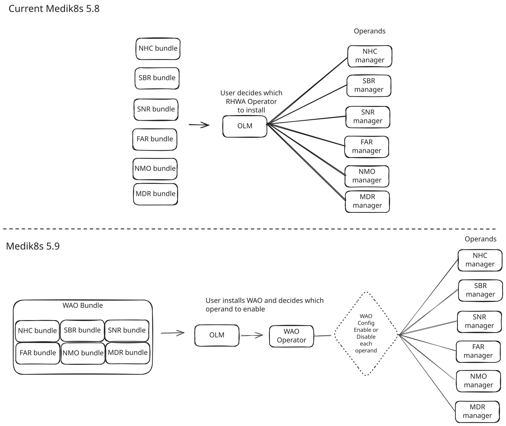
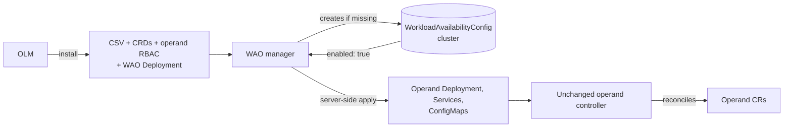

# Consolidate the medik8s operators into the Workload Availability Operator

## Summary

The Workload Availability Operator (WAO) packages the six medik8s operators
(NHC, SNR, SBR, FAR, MDR, NMO) as one OLM package. Each existing operator
becomes an *operand*: an unmodified controller-manager that WAO deploys when an
administrator enables it and removes when they disable it. One CSV installs all
operand APIs and permissions, and a single cluster-scoped
`WorkloadAvailabilityConfig` selects which operands run. Phase 1 changes how the
operators are installed and distributed, not what they do.

## Motivation & Problem Space

Today each operator is a separate OLM package with its own CSV, its own CRD
ownership and its own release and upgrade lifecycle. That has two costs:

- **Users** see six things to find, install and upgrade, instead of one product.
- **The team** builds, tests, publishes and supports six packages for what is
  presented as one offering.

Phase 1 targets both: how a user sees and installs one operator, and how the team
distributes the operator. The high-level work is tracked in [RHWA-1841](https://redhat.atlassian.net/browse/RHWA-1841).

## Goals

- One OLM package and one CSV install the APIs, RBAC and controller of all six
  operators.
- No change to operator behavior. Operand controller code and APIs are not
  modified.
- Opt-in activation. Every component is `Disabled` after install, and install
  creates no remediation policy, remediation request, native config or node
  agent.
- Per-component enable/disable and manager CPU/memory settings from one
  resource.
- Operand development stays in the operand repositories. Picking up an
  upstream change is a mechanical copy plus regeneration, and drift between the
  copy and the generated output is detected by checks, not by review.

## Non-Goals

- Changing the behavior or API of any operator.
- Merging the operators' controllers, CRDs or code into one codebase. The
  exception is admission webhooks, described in
  [Admission webhooks](#admission-webhooks).
- Running a standalone operator alongside WAO. WAO's CSV owns the operand
  CRDs, so the two cannot coexist on one cluster.
- A separate Kubernetes (non-OpenShift) bundle. The current bundle targets
  OpenShift with OLM v0; `bundle-k8s` is an alias, not a distinct build.

## Proposal & Design Details

The implementation lives in
[medik8s/workload-availability-operator](https://github.com/medik8s/workload-availability-operator).
Present-tense statements describe that repository as of 2026-11-17; statements
with "will" describe work not yet done.



### Who does what



| Stage | OLM | WAO | Operand |
| --- | --- | --- | --- |
| Install | Creates all CRDs, all operand ServiceAccounts/Roles/bindings, WAO Deployment | Creates the `cluster` config with every component disabled if none exists; never overwrites one | Nothing runs |
| Enable | | Applies the operand's Deployment, Services and ConfigMaps; reports readiness | Starts and reconciles its own CRs |
| Disable | | Removes what it applied | Manager stops; objects it created itself can remain (see below) |
| Uninstall | Removes CSV-owned objects | A finalizer on the config removes remaining operand objects, but only while WAO is running | |

### The `WorkloadAvailabilityConfig` API

Group `workloadavailability.medik8s.io/v1alpha1`, cluster-scoped, short name
`wac`. A CEL rule on the CRD allows only the name `cluster`.

```yaml
apiVersion: workloadavailability.medik8s.io/v1alpha1
kind: WorkloadAvailabilityConfig
metadata:
  name: cluster
spec:
  components:
    nodeHealthCheck:                 # one entry per operand
      enabled: false                 # default false
      manager:
        resources:                   # optional; omitted values keep packaged defaults
          requests: {cpu: 100m, memory: 128Mi}
          limits:   {cpu: "1",  memory: 512Mi}
```

| Field | Contract |
| --- | --- |
| `spec.components.<key>.enabled` | Bool, default `false`. Keys: `nodeHealthCheck`, `selfNodeRemediation`, `storageBasedRemediation`, `nodeMaintenance`, `fenceAgentsRemediation`, `machineDeletionRemediation`. |
| `spec.components.<key>.manager.resources` | `requests`/`limits` with `cpu` and `memory` quantities. Applies to the manager container only, does not enable the component, validated by CEL and re-checked at enable time. |
| `status.conditions` | `Available`, `Progressing`, `Degraded` describe *reconciliation*. `Available` is true even with everything disabled and does **not** mean workloads are protected. |
| `status.components[]` | Per component: `desiredState`, `phase` (`Disabled`, `Progressing`, `Available`, `Degraded`, `DisableIncomplete`), `deployments[]`, `admissionReady`, `retainedResources[]`, `message`. |
| `status.installNamespace`, `status.releaseSet` | Namespace operands run in; the image references this build will deploy. |

### How an operand's configuration becomes part of WAO

The design rests on one rule: **copy upstream configuration verbatim, then
adjust it only through overlays.**

```text
config/operands/<operand>/
  config/       verbatim copy of the operand repo's config/ ; replaced on refresh, never edited
  overlays/
    rbac/       install-time slice  -> WAO CSV / bundle
    runtime/    enable-time slice   -> internal/operands/manifests/<operand>/objects.yaml
config/operands/crd/                 -> CRDs for all operands, included by WAO's config/crd
```

| Slice | Contents | Produced by | Created by |
| --- | --- | --- | --- |
| CRDs | The operand's `config/crd` | `make bundle` | OLM, at WAO install |
| RBAC | ServiceAccount, Role, RoleBinding, ClusterRole, ClusterRoleBinding only; everything else deleted by the overlay | `make bundle`, with operand ServiceAccounts passed to operator-sdk so their roles fold into the CSV | OLM, at WAO install |
| Runtime | Deployment, Service, ConfigMap, with WAO adjustments | `make operand-manifests` writes `objects.yaml`, embedded with `go:embed` | WAO, when the operand is enabled |

The runtime overlay carries the adjustments that WAO needs and upstream does not
provide: a target-namespace placeholder, image placeholders, a
`workloadavailability.medik8s.io/component` label on every pod and Service
selector (six managers share one namespace and some upstream selectors would
otherwise match another operand), and OpenShift service-ca wiring for webhook
certificates. At reconcile WAO substitutes the namespace and images, labels the
objects, orders Services before Deployments, and applies them with server-side
apply.

Images are selected in `operands.yaml` and synchronized into `RELATED_IMAGE_*`
variables on the WAO manager. Generation fails if any rendered `image:` field is
not a WAO placeholder, so an unmapped upstream image cannot deploy by default.
`make verify-operand-manifests` regenerates the output and fails on drift; bundle
freshness is checked by `make bundle-reset` plus a no-changes check in CI.

During development, `operands.yaml` points at a `wao` branch in each operand
repository and at `:wao` image tags. These branches track the `medik8s-5.8`
branches closely and exist to limit churn while WAO is built and tested. They
are not intended to carry WAO-specific changes to the operands. For 5.9, WAO
will eventually track `main` in the operand repositories instead.

Where a change belongs:

| Change | Where |
| --- | --- |
| Pick up an upstream change | `make update-<operand>-manifests` (replaces the copy) |
| Change an operand image | `operands.yaml`, then `make operand-manifests` |
| Fix how an operand is packaged into the CSV | `overlays/rbac/` |
| Fix how an operand runs in WAO's namespace | `overlays/runtime/` |
| Edit a copied file | Never; patch from an overlay |

### Enable and disable semantics

- **Enable** applies the operand's rendered objects. WAO never adopts an
  existing object it did not create; a conflict is reported as `Degraded`.
  Phase becomes `Available` when the manager Deployments are ready and, where
  applicable, webhook CA bundles are injected.
- **Disable** is *manager-level*. WAO removes what it applied and the manager
  stops. It does not remove what the operand itself created: SNR's agent
  DaemonSet, default config and certificate Secret, SBR's agents and storage
  objects, NHC's aggregation ClusterRole and ConsolePlugin. WAO reports these
  as `DisableIncomplete` with the objects in `retainedResources`.
- Native objects a stopped manager would have reconciled are stranded: an
  active `NodeMaintenance` keeps its node cordoned, and SNR, SBR, FAR and MDR
  remediation objects keep their finalizers. A component should be disabled only
  when it has no active work. Disabling a remediator (SNR, SBR, FAR or MDR)
  while a `NodeHealthCheck` still references its template leaves later
  remediation requests unprocessed, because the remediator's manager is
  stopped. Pause or disable the dependent policy first, and keep it paused until
  the remediator is enabled again.
- Enabling can have immediate effects: SNR starts privileged node agents on
  every eligible node, behaving like a standalone SNR install.
- **Uninstall** must remove the config while WAO is still running. OLM removes
  the WAO Deployment and the CSV-owned RBAC, but it does not remove the
  `cluster` config. With no running WAO, nothing processes the config's
  finalizer, so the Deployments, Services and ConfigMaps WAO applied for
  enabled operands stay behind. The finalizer removes only objects WAO applied.
  It does not remove anything listed in `retainedResources`: it logs them and
  then removes itself. The order is:
  1. Disable every enabled component, and wait for each phase to be `Disabled`
     or `DisableIncomplete`. Finish or delete active work first (see above).
  2. Remove what `retainedResources` lists, while WAO still runs. Agent
     DaemonSets, such as SNR's `self-node-remediation-ds`, have an owner
     reference to the component's config (`SelfNodeRemediationConfig` for SNR,
     `StorageBasedRemediationConfig` for SBR). Deleting that config removes the
     DaemonSet through garbage collection, and the phase then becomes
     `Disabled`. WAO admission handles the SNR config delete, so WAO must be
     running. Other retained objects, such as NHC's aggregation ClusterRole and
     ConsolePlugin, are left by the operand. WAO never deletes them, so they
     stay after uninstall unless the administrator removes them.
  3. Delete the `cluster` config, and wait for its finalizer to complete.
  4. Delete the Subscription and the CSV.

### Admission webhooks

Operand webhooks are the one place the "operands are unmodified" rule bends.

An operand's own webhook is unavailable whenever that operand is disabled, and
a `Fail`-policy webhook with no backend blocks even deletion of the operand's
objects. Removing the registration on disable avoids that block but
leaves the operand's objects unvalidated. To keep admission consistent, WAO moves
the admission handlers of four operands into the WAO manager process:

| Operand | Admission served by WAO | Status |
| --- | --- | --- |
| FAR, NHC, NMO, SNR | Yes, in every state (enabled or disabled) | Done; documented per operand in the WAO repository |
| SBR | No. The SBR webhook shipped disabled in 5.8, so WAO has none. A webhook may be added for 5.9 if the newer SBR design includes one, and WAO would then be updated to deploy it | None today |
| MDR | No. MDR has no webhook | None needed |

For those four operands:

- WAO imports each operand's public packages and copies only the files Go does
  not let another module import (`internal/`) into `internal/webhooks/<operand>/`.
  The upstream revision and each adaptation are recorded in a `SOURCE.md` per
  operand, and tests pin the behavior WAO must preserve.
- The registration ships in the CSV (`webhookdefinitions`), so OLM installs it
  with WAO. The operand's runtime overlay deletes its own webhook
  configuration. WAO does not apply, own or delete the registration.
- `failurePolicy` is preserved exactly as upstream defines it, and is never
  relaxed (for example from `Fail` to `Ignore`). Each WAO replica starts the
  listener before serving and the manager exits if setup fails, including when
  the operand is disabled.

## Risks, Security & Mitigations

### Security posture

WAO is a highly privileged operator, comparable to a cluster-admin install. The
operators it packages can reboot, fence and delete nodes and drain workloads,
and their permissions reflect that. Installing WAO is a decision for the
cluster administrator, and **the WAO namespace is a cluster-admin-only
namespace**. The design preserves the behavior the separate operators had
wherever it can, instead of reducing it.

No formal security review of this design has been done.

### Risks

| Risk | Impact | Mitigation | Status |
| --- | --- | --- | --- |
| **Operand privileges exist from install, even with every component `Disabled`.** OLM creates all six operands' ServiceAccounts and RBAC from the CSV: SCC `use` on `privileged` (SNR, SBR), cluster-wide `clusterroles`/`clusterrolebindings` management (NHC, SBR), cluster-wide Secret reads (FAR), an `oauth.openshift.io` wildcard (NMO). Anyone who can create a pod, or request a token, for one of these ServiceAccounts in the WAO namespace can use its access. A user who enables only NMO still has the others' grants. | Privilege escalation by a non-admin with access to the WAO namespace. | Treat the namespace as cluster-admin-only and say so in the install documentation. The grants are those each operator's own configuration defines, and WAO's own role does not include the operand rules. The alternative, creating RBAC at enable time, would put the union of all rules, plus `bind`, on WAO's own ServiceAccount permanently (see [Alternatives](#alternatives-considered)). | Behavior preserved. Documentation of the access-control guidance **will** be written. |
| **Admission depends on WAO availability.** The FAR, NHC, NMO and SNR handlers run in the WAO manager with their upstream `failurePolicy` (nine of the ten entries are `Fail`; the one `Ignore` is an SNR entry; NHC includes `DELETE`). If no WAO replica answers, creating or updating those objects fails. A WAO replica also exits at startup if its admission setup (for example reading cluster capabilities, 30 s limit) fails, even when the operand is disabled. | An unavailable WAO blocks changes to remediation policy and requests, including during a WAO restart or upgrade. Previously the exposure was limited to each operand's own pod. | WAO runs two replicas, and every replica serves admission; only the leader reconciles. Anti-affinity between replicas is preferred, not required, and the WAO configuration has no PodDisruptionBudget. `failurePolicy` is never relaxed. | Partly mitigated. Whether to require anti-affinity or add a PDB is open. |
| **Copied webhook handlers drift from upstream.** The files WAO must copy (from `internal/`) are pinned in `SOURCE.md`; the rest is imported through the Go module. | WAO could admit or reject differently from the operand it replaces. | Each operand has tests that pin the behavior WAO must preserve, and the pin records the upstream revision. | Tests pin the behavior. No automated check for a stale pin exists today. The assumption is that webhook logic will move to WAO in future, which makes drift from the operand less of a concern. A later cleanup to remove the webhooks from the operands is likely desired. |
| **Disable strands active work.** Disable is manager-level. An active `NodeMaintenance` keeps its node cordoned; SNR, SBR, FAR and MDR remediation objects keep their finalizers; agent DaemonSets remain. | A disabled operand can leave nodes cordoned or objects undeletable. | WAO reports `DisableIncomplete` with `retainedResources`, and documents "disable only with no active work". WAO does not block the disable. | Documented. A guard is not part of phase 1. |
| **Deleting the `cluster` config removes all operand workloads.** Its finalizer removes the objects WAO applied. WAO recreates an all-`Disabled` config at its next start. | Deleting it while components are enabled stops remediation until an admin re-enables them. | Cluster-admin-only access, and the documented uninstall procedure disables components first. | Documented. |
| **Migration removes protection for a time.** The upgrade deletes the old operators and CRs, then installs WAO. | Remediation does not run during the window. | A maintenance window; the procedure refuses to run while a remediation or node maintenance is in flight; CRs are backed up; rollback reinstalls from the backup. | Implemented as a proof of concept (see [Upgrade / Downgrade Concerns](#upgrade--downgrade-concerns)). |
| **A leftover standalone operator conflicts with WAO.** WAO's CSV owns the operand CRDs. | OLM refuses the overlap, or WAO reports an ownership conflict instead of adopting objects it did not create. | Never adopt existing objects; the migration removes the old operators first; documented as unsupported to mix. | Implemented. |
| **A WAO upgrade changes every enabled operand at once.** One upgrade replaces the manifests and images of all enabled operands, which restarts their managers and can roll agent DaemonSets (SNR, SBR). A rollout during active remediation can disrupt it; SNR has had a bug where agent DaemonSet rollouts caused false reboots. | Operand managers and agents restart together, possibly during a remediation. | Upgrades are done in a maintenance window with no remediation in flight. This holds for the medik8s operators in general today and is not specific to WAO; WAO differs in moving all enabled operands in one step. | Accepted for now. Safer upgrades are future work (see [Open Questions](#open-questions)). |

## Alternatives Considered

- **Make NHC the main operator.** Keep NHC as the one operator, have it adopt
  the other operators' CRDs, and rename it to `workload-availability-operator`.
  This would avoid introducing a new operator. The team expected that OLM would
  not allow renaming the operator package from `node-healthcheck-operator` to
  `workload-availability-operator`, and did not pursue it. This was a rough idea
  and the OLM behavior was not investigated in depth, so the exclusion rests on
  that expectation, not on a confirmed limitation.
- **An umbrella operator in the style of HCO.** Keep the six operators as they
  are and add a top-level operator that deploys them and creates their CRs, as
  the [Hyperconverged Cluster Operator](https://github.com/kubevirt/hyperconverged-cluster-operator)
  does for KubeVirt and its adjacent operators. This would make installation
  simpler for the user. It was only lightly considered, because it does not
  simplify distribution: the team would still build, test and publish each
  operator, plus the umbrella. Distribution is half of the goal.
- **WAO creates operand RBAC at enable time.** An earlier version of WAO
  rendered each operand's ServiceAccounts and roles when the component was
  enabled. That gives least privilege while disabled. It needed a union
  ClusterRole of every operand rule plus `bind` on WAO's own ServiceAccount, so
  one standing identity would hold everything, and it needed a large
  bundle-unpacking pipeline. It was replaced by OLM-owned RBAC folded into the
  CSV ([WAO issue #12](https://github.com/medik8s/workload-availability-operator/issues/12)),
  the pattern OADP uses. The latent privilege moves from
  WAO into the operand ServiceAccounts, and the pipeline becomes a plain copy.
- **Merge the six operators into one codebase.** Combine the controllers,
  CRDs and code into a single operator. This was considered out of scope for
  this phase. The goal is the fewest changes, and deploying each operand close
  to how it runs today is a smaller change than merging code.
- **WAO with the operators as operands (this proposal).** One package, one CSV,
  one set of release artifacts, with operator code and APIs left in their own
  repositories. The cost is the one-time migration from separately installed
  operators (see [Upgrade / Downgrade Concerns](#upgrade--downgrade-concerns)).

## Test Plan

**In the WAO repository today:**

- Go unit and `envtest` suites (`make test`), including the admission handlers
  copied from FAR, NHC, NMO and SNR and tests that pin the behavior WAO
  preserves.
- Offline checks (`make test-offline`, `make verify-operand-manifests`) that
  regenerate the embedded runtime objects and fail on drift, check that each
  RBAC overlay emits only RBAC kinds, and check bundle shape.
- CI runs the Go suites, lint, and the offline checks. The repository has no
  e2e tests.

**End to end:** e2e tests are created in
[openshift/rhwa-system-tests](https://github.com/openshift/rhwa-system-tests).
Work is in progress there to run the suites against operands managed by WAO.

## Rollout, Migration & Graduation Criteria

WAO is intended to ship as the single medik8s package in release 5.9. There is
no in-place OLM upgrade from the separate 5.8 operators. The team accepted a
**non-automatic upgrade**: the administrator runs a migration procedure, which
[medik8s-cli](https://github.com/medik8s/medik8s-cli) automates. See
[Upgrade / Downgrade Concerns](#upgrade--downgrade-concerns).

- **Defaults:** a new install creates no operand workloads, because every
  component is `Disabled`. Nothing starts until an administrator enables it.
- **Rollback:** a manual process. The user decides to roll back and runs it.
  It restores the state captured in the backup: it removes WAO and reinstalls
  the original operators with their custom resources from that backup.
  `medik8s-cli` provides this as a proof of concept.
- **Graduation to `implemented`:**
  - The single bundle and catalog build and publish from the WAO repository.
  - All six operands can be enabled and disabled, covered by e2e tests in
    `rhwa-system-tests` that run in Prow against WAO on OpenShift 5.1 with
    OLM v0 (see the [Test Plan](#test-plan)).
  - The migration procedure is verified end to end from a 5.8 installation,
    including rollback.

## Upgrade / Downgrade Concerns

The upgrade from 5.8 to the consolidated release is a documented, user-initiated
procedure, not an OLM upgrade. The standalone operators cannot coexist with WAO
because WAO's CSV owns the operand CRDs, so the old operators must be removed
first.

1. Enter a maintenance window.
2. Pause every `NodeHealthCheck` (`spec.pauseRequests`), then ensure no
   remediation or node maintenance is in flight. Keep them paused until the
   operators are removed.
3. Back up the existing custom resources.
4. Delete the custom resources and uninstall the existing operators.
5. Install WAO.
6. Recreate the custom resources from the backup, enabling the components that
   were in use.

State of the automation today: the scripts in `medik8s-cli` (`scripts/poc/`)
implement backup, delete, install and rollback, and refuse to run a destructive
step while a remediation or node maintenance is in progress. They do not yet
pause `NodeHealthCheck` policies (step 2). They are marked as
proofs of concept for disposable clusters. The `kubectl medik8s` plugin that
would wrap them is designed but not implemented.

After this one-time migration, later WAO versions upgrade through OLM in the
usual way.

Downgrade from WAO to the separate operators is a manual rollback that the user
decides on and executes. It uses the state captured in the backup taken in
step 3, so changes made to the custom resources after that backup are not
restored.

## Open Questions

- **Disable is manager-level:** disabling an operand leaves what the operand
  created itself (for example SNR's agent DaemonSet and SBR's agents), and
  can strand active work. Will WAO ever clean these up on disable, or block a
  disable while work is active, and if so when?
- **Safer upgrades:** upgrades need a maintenance window today. What would
  allow upgrading without one, and does WAO's single upgrade of all operands
  make that easier or harder?
- **Admission availability:** require anti-affinity or add a
  PodDisruptionBudget for the WAO Deployment?

## Terminology

- **WAO:** Workload Availability Operator.
- **Operand:** a medik8s operator that WAO deploys and manages.
- **NHC / SNR / SBR / FAR / MDR / NMO:** Node Health Check, Self Node
  Remediation, Storage Based Remediation, Fence Agents Remediation, Machine
  Deletion Remediation, Node Maintenance.
- **OLM:** Operator Lifecycle Manager.
- **OLM v0:** the classic Operator Lifecycle Manager, as opposed to OLM v1.
- **CSV:** ClusterServiceVersion, the OLM description of an installation.
- **CRD / CR:** CustomResourceDefinition / custom resource.
- **RBAC:** role-based access control.
- **CEL:** Common Expression Language, used for CRD validation rules.
- **SCC:** OpenShift SecurityContextConstraints.
- **HCO:** Hyperconverged Cluster Operator, KubeVirt's umbrella operator.
- **PDB:** PodDisruptionBudget.
- **OADP:** OpenShift API for Data Protection.
